# Conception
## Conception - App de Réservation de Places de Cinéma

## 1. Modèle de Données
### Diagramme Entité-Association (Sprint 1)

### Diagramme Entité-Association mis à jour
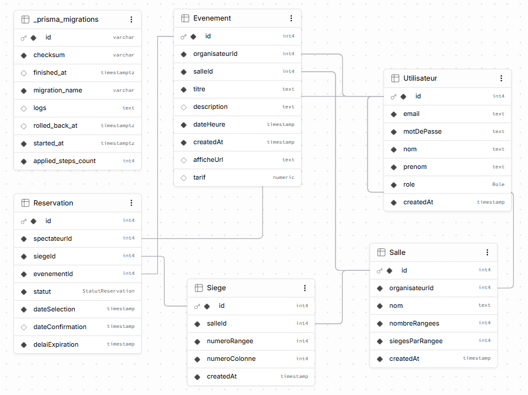

Mis à jour suite à l'ajout des colonnes `tarif` et `affiche_url` sur la table `Evenement`. Ces colonnes auraient dû être présentes dès la conception initiale du diagramme, puisque chaque événement a une affiche et un tarif — elles avaient été oubliées.

Ce diagramme ne montre pas encore les ajouts du sprint 2 : la table `SECTIONS` (#11), la table `IDENTITES_EXTERNES` (#114), la colonne `section_id` des sièges, les colonnes de connexion externe et d'annulation. Les détails ci-dessous, eux, suivent le schéma Prisma actuel (`backend/prisma/schema.prisma`).

### Détails des Entités (schéma actuel, fin du sprint 2)
### UTILISATEURS (Connexion)
id : Entier, clé primaire
email : Chaîne, unique (index pour login)
mot_de_passe : Hash bcrypt (jamais stocké en clair), **facultatif depuis le sprint 2** : null pour un compte créé par une connexion externe (GitHub, Google, Microsoft). Les comptes de démonstration et les comptes inscrits par courriel en ont un.
github_id : Chaîne, unique, facultatif — identifiant du compte GitHub relié (sprint 2, #101)
nom, prenom : Chaînes obligatoires
role : ENUM('spectateur', 'organisateur', 'administrateur')
spectateur : Consulte événements, réserve sièges, annule ses réservations
organisateur : Crée salles/événements, voit stats de vente, annule toute réservation
administrateur : Supervise toute la plateforme (tous les événements et leurs ventes, #36)
created_at : Timestamp création

**Rôle par défaut** : un compte créé à sa première connexion GitHub, Google ou Microsoft reçoit le rôle `spectateur`. Le rôle `organisateur` se choisit à l'inscription par courriel et mot de passe ; `administrateur` ne vient que des comptes de démonstration.

### IDENTITES_EXTERNES (Connexion Google / Microsoft, #114)
id : Entier, clé primaire
fournisseur : Chaîne (`google`, `microsoft`)
sujet : Chaîne — le `sub` de l'ID token OpenID Connect, identifiant stable du compte chez ce fournisseur
utilisateur_id : FK → UTILISATEURS (non nul, suppression en cascade)
created_at : Timestamp création
Contrainte : unique (fournisseur, sujet). Un utilisateur peut avoir plusieurs identités externes (ex. Google et Microsoft).

### SALLES (Créées par organisateur)
id : Entier, clé primaire
organisateur_id : FK → UTILISATEURS (non nul, créateur)
nom : Chaîne (ex: "Salle du Cégep", "Théâtre Principal")
nombre_rangees : Entier (ex: 10 rangées)
sieges_par_rangee : Entier (ex: 15 sièges par rangée)
created_at : Timestamp
Contrainte : UNIQUE(organisateur_id, nom) — un organisateur a une salle unique par nom
Modifiable (nom, rangées, sièges par rangée) tant qu'aucun événement ne l'utilise (#10) ; les sièges sont alors régénérés.

### SECTIONS (Sections tarifaires d'une salle, #11)
id : Entier, clé primaire
salle_id : FK → SALLES (non nul, suppression en cascade)
nom : Chaîne (ex. "Parterre", "Balcon")
prix : Décimal(8,2) — prix d'un siège de cette section
couleur : Chaîne `#RRGGBB` — couleur d'affichage sur les plans (#34)
created_at : Timestamp
Contrainte : UNIQUE(salle_id, nom)
Modifiables tant qu'aucun événement n'utilise la salle, comme la salle elle-même.

### SIEGES (Générés à partir de SALLES)
id : Entier, clé primaire
salle_id : FK → SALLES (non nul)
numero_rangee : Entier (1 à nombre_rangees)
numero_colonne : Entier (1 à sieges_par_rangee)
created_at : Timestamp
section_id : FK → SECTIONS, facultatif (mis à null si la section est supprimée) — un siège appartient à au plus une section. Sans section, il est vendu au tarif de l'événement.
Contrainte : UNIQUE(salle_id, numero_rangee, numero_colonne) — pas de siège dupliqué
Pas de statut ici — le statut est dans RESERVATIONS pour chaque événement (un siège peut être libre pour l'événement A et réservé pour l'événement B)

### EVENEMENTS (Créés par organisateur, associés à une salle)
id : Entier, clé primaire
organisateur_id : FK → UTILISATEURS (non nul, créateur)
salle_id : FK → SALLES (non nul, immuable après création)
titre : Chaîne (ex: "Concert des Anciens")
description : Texte court, optionnel
affiche_url : Chaîne, optionnel — URL de l'image uploadée via `POST /api/evenements/affiche` (migration `ajouter_affiche_evenement`)
date_heure : DateTime (ex: 2024-10-15 20:00:00, en UTC)
tarif : Décimal(8,2), optionnel — prix du billet (migration `ajouter_tarif_evenement`)
created_at : Timestamp
Pas de état "complet" — calculé dynamiquement depuis les réservations confirmées

### RESERVATIONS (Associe spectateur + siège + événement)
id : Entier, clé primaire
spectateur_id : FK → UTILISATEURS (non nul)
siege_id : FK → SIEGES (non nul)
evenement_id : FK → EVENEMENTS (non nul)
statut : ENUM('en_selection', 'confirmee', 'annulee')
en_selection : Siège sélectionné, en attente de confirmation (délai limité)
confirmee : Siège réservé définitivement
annulee : Réservation annulée (siège libéré), par l'organisateur (#14) ou par le spectateur avant l'événement (#12). La ligne est conservée : le spectateur la voit dans son historique.
date_selection : Timestamp (quand le siège a été cliqué)
date_confirmation : Timestamp NULL (rempli seulement quand confirmee)
delai_expiration : Timestamp (date jusqu'à laquelle en_selection reste valide)
motif_annulation : Texte, facultatif (500 caractères max) — motif donné par l'organisateur à l'annulation (#14)
date_annulation : Timestamp NULL — rempli à l'annulation
actif : Booléen, `true` par défaut, **NULL une fois la réservation annulée** (#14)
Contrainte critique : UNIQUE(siege_id, evenement_id, actif) → une seule réservation active par siège et par événement. Postgres considère deux NULL comme différents : les réservations annulées s'accumulent sans bloquer le siège, qui peut être réservé de nouveau (voir décision 10).
Contrainte : Si statut = 'confirmee', date_confirmation est non nul

## 2. Routes Principales
### Routes Détaillées (état actuel du code)

#### Authentification — `backend/src/modules/auth`
| Méthode | Route | Auth | Détails |
|---------|-------|------|---------|
| POST | `/api/auth/register` | Publique | Inscription par courriel. Corps : `{ email, motDePasse, nom, prenom, role }`, avec `role` = `spectateur` ou `organisateur` (`administrateur` refusé, 400). 409 si le courriel est déjà utilisé. |
| POST | `/api/auth/login` | Publique | Corps : `{ email, password }`. Réponse : `{ token, user }`. 401 (message générique) si email ou mot de passe invalide, ou si le compte n'a pas de mot de passe (compte GitHub). |
| GET | `/api/auth/me` | `Authorization: Bearer <token>` | Retourne l'utilisateur courant (déduit du token, sans mot de passe). |
| GET | `/api/auth/github` | Publique | Redirige vers GitHub (OAuth 2). Un `state` aléatoire est gardé dans un cookie httpOnly (10 min) contre le CSRF. |
| GET | `/api/auth/github/callback` | Publique (appelée par GitHub) | Vérifie le `state`, échange le code contre un jeton côté serveur, lit le profil et le courriel vérifié, retrouve ou crée l'utilisateur (rôle `spectateur`), puis redirige vers `<frontend>/connexion-externe#token=<JWT>` (ou `#erreur=<message>`). |
| GET | `/api/auth/fournisseurs` | Publique | Liste des fournisseurs de connexion configurés (ex. `["github", "google"]`) : le frontend n'active que ces boutons. |
| GET | `/api/auth/:fournisseur` | Publique | Connexion OpenID Connect (`google`, `microsoft`) : redirige vers le fournisseur avec `state`, `nonce` et défi PKCE, gardés dans un cookie httpOnly. 404 si fournisseur inconnu. |
| GET | `/api/auth/:fournisseur/callback` | Publique (appelée par le fournisseur) | Vérifie le `state`, échange le code (avec le `code_verifier` PKCE), vérifie l'ID token (signature, audience, émetteur, nonce), retrouve ou crée l'utilisateur, puis redirige comme pour GitHub. |

*L'inscription a été retirée le 26 octobre avec la connexion GitHub (Seats-Backend PR #34), puis remise le jour même (Seats-Backend PR #36, Seats-Frontend PR #123). Sur la page d'inscription, les boutons de connexion externe envoient le rôle choisi (`?role=`), voir la décision 7.*

#### Salles — `backend/src/modules/salles`
| Méthode | Route | Auth | Détails |
|---------|-------|------|---------|
| GET | `/api/salles` | Bearer, rôle `organisateur` | Liste les salles de l'organisateur courant (`req.user.id`). |
| POST | `/api/salles` | Bearer, rôle `organisateur` | Corps : `{ nom, nombreRangees, siegesParRangee }`, `organisateurId` vient du token. Génère les sièges associés. 409 si le nom existe déjà pour cet organisateur. |
| GET | `/api/salles/:id` | — | Détail d'une salle avec ses sièges, ses sections et son nombre d'événements. 404 si introuvable. |
| PUT | `/api/salles/:id` | Bearer, rôle `organisateur` | Modifie nom et dimensions (#10), sièges régénérés. 409 si un événement utilise déjà la salle. |
| PUT | `/api/salles/:id/sections` | Bearer, rôle `organisateur` | Remplace toutes les sections (#11). Corps : `{ sections: [{ nom, prix, couleur, siegeIds }] }`. 400 si un siège est dans deux sections, 409 si un événement utilise déjà la salle. |

#### Événements — `backend/src/modules/evenements`
| Méthode | Route | Auth | Détails |
|---------|-------|------|---------|
| GET | `/api/evenements` | — | Liste tous les événements. |
| POST | `/api/evenements` | Bearer, rôle `organisateur` | Corps : `{ salleId, titre, description?, dateHeure, afficheUrl?, tarif? }`, `organisateurId` vient du token. 400 si `salleId` invalide. |
| GET | `/api/evenements/:id/plan` | — | Plan de salle de l'événement : sièges avec leur état (`reserve` / `libre`), leur section et leur prix (section, sinon tarif de l'événement), et les sections de la salle. 404 si événement introuvable. |
| GET | `/api/evenements/:id/ventes` | Bearer, rôle `organisateur` | Tableau de bord des ventes (#13) : chaque siège `vendu` / `en_selection` / `libre` avec le spectateur, les totaux et la recette. 403 si l'événement appartient à un autre organisateur. |
| POST | `/api/evenements/affiche` | Bearer, rôle `organisateur` | Corps : image brute (`Content-Type: image/png`, etc., 5 Mo max). Upload l'affiche, retourne son URL. |

#### Réservations — `backend/src/modules/reservations`
| Méthode | Route | Auth | Détails |
|---------|-------|------|---------|
| GET | `/api/reservations` | Bearer, rôle `spectateur` | Liste les réservations de l'utilisateur courant (`req.user.id`), avec événement, siège et prix de la place. Les annulées restent dans la liste, avec leur motif. |
| POST | `/api/reservations` | Bearer requis, rôle `spectateur` | Corps : `{ evenementId, siegeIds: [...] }`. `spectateurId` vient toujours du token, jamais du corps (sinon un client pourrait réserver au nom d'un autre utilisateur). 409 si un siège est déjà pris ou en cours de sélection par un autre spectateur (#31). |
| POST | `/api/reservations/:id/annulation` | Bearer, rôle `organisateur` | Annulation par l'organisateur (#14). Corps : `{ motif? }`. 403 si la réservation concerne l'événement d'un autre organisateur, 409 si déjà annulée. |
| POST | `/api/reservations/:id/annuler` | Bearer, rôle `spectateur` | Annulation par le spectateur (#12). 403 si la réservation ne lui appartient pas, 400 si l'événement est passé, 409 si déjà annulée. |

#### Administration — `backend/src/modules/admin`
| Méthode | Route | Auth | Détails |
|---------|-------|------|---------|
| GET | `/api/admin/evenements` | Bearer, rôle `administrateur` | Tous les événements de la plateforme (#36), à venir d'abord puis passés, avec organisateur, salle et nombre de places vendues. |
| GET | `/api/admin/evenements/:id` | Bearer, rôle `administrateur` | Détail d'un événement et de ses ventes siège par siège, quel que soit son organisateur. |

#### Temps réel — Socket.IO (`backend/src/realtime.js`)
Même serveur et même port que l'API. Chaque événement a son salon (`evenement:<id>`). Le client envoie le JWT dans `handshake.auth.token` : sans token valide, il voit le plan bouger mais ne peut rien sélectionner.

| Sens | Message | Détails |
|------|---------|---------|
| client → serveur | `plan:rejoindre` / `plan:quitter` | Entre dans le salon d'un événement ou le quitte. À l'entrée, le serveur répond `plan:selections` avec les sièges déjà en sélection. |
| client → serveur | `siege:selectionner` / `siege:deselectionner` | Spectateur connecté seulement. Refusé si le siège est déjà en sélection par quelqu'un d'autre (#31). Une sélection expire après 60 s. |
| serveur → clients | `siege:selectionne` / `siege:libere` | Un siège passe « en sélection » ou redevient libre (désélection, expiration, déconnexion). |
| serveur → clients | `sieges:reserves` | Après une réservation confirmée, les sièges passent à « réservé » chez tout le monde. |
| client → serveur | `ventes:rejoindre` / `ventes:quitter` | Abonnement aux ventes d'un événement (#35), dans un salon séparé `ventes:<id>`. Refusé si le client n'est pas l'organisateur de cet événement (vérifié par le serveur). |
| serveur → organisateur | `ventes:maj` | Les ventes recalculées (mêmes données que `GET /api/evenements/:id/ventes`), poussées après chaque réservation ou annulation sur l'événement. |

## 3. Maquettes
### Maquettes 1 :  Pages Inscription
*Sprint 2 : sous le bouton « Créer mon compte », la page propose aussi « Continuer avec GitHub / Google / Microsoft », avec le rôle sélectionné (spectateur ou organisateur). La page de connexion affiche les mêmes boutons sous le formulaire.*

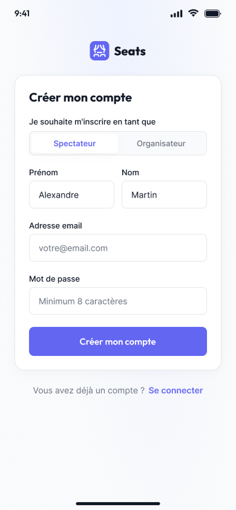

### Maquettes 2 :  Pages Connexion
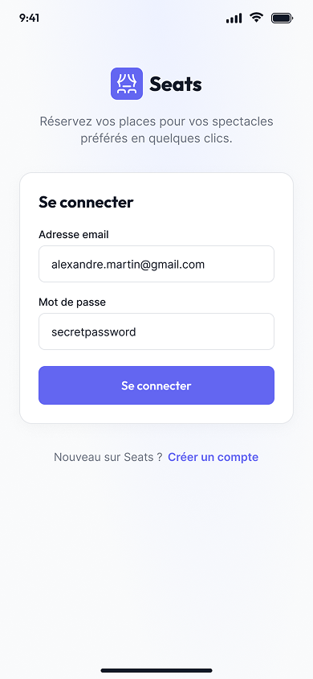

### Maquettes 3 :  Listes des évenements
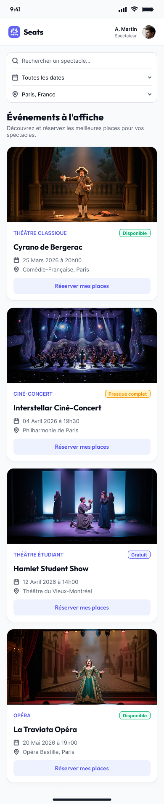

### Maquettes 4 :  Plan de Salle Interactif
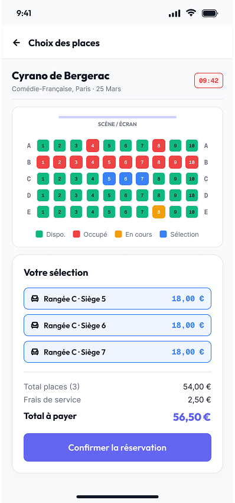

### Maquettes 5 :  Confirmation de Réservation
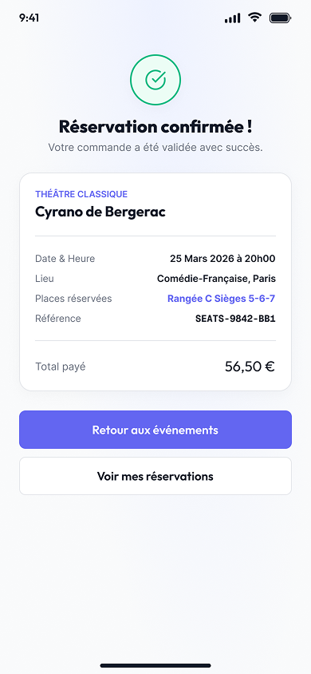

### Maquettes 6 :  Pages Mes Réservations
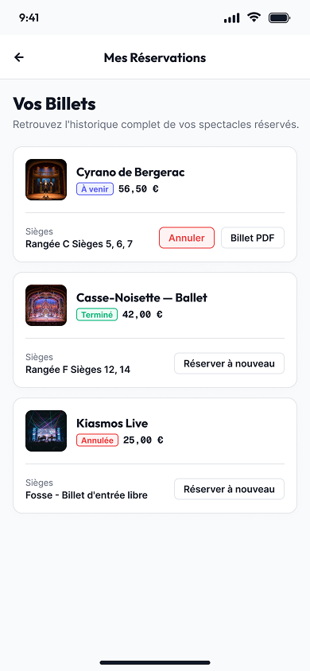

### Maquettes 7 :  Dashboard Organisateur
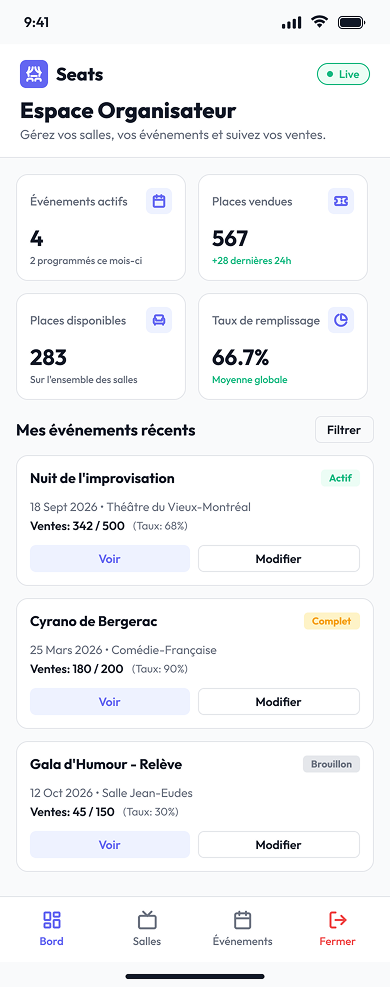

### Maquettes 8 :  Création d'un Évènement
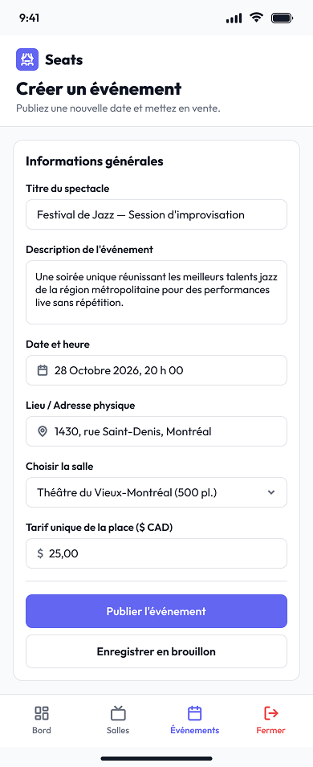

### Maquettes 9 :  Créer une Salle
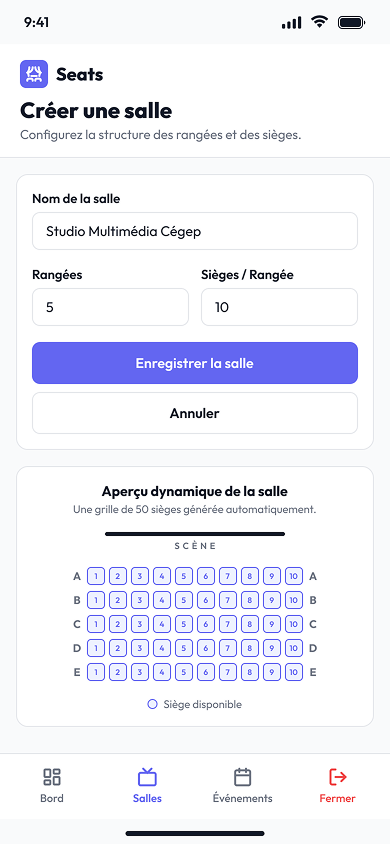

### Maquettes 10 :  Dashboard Admin
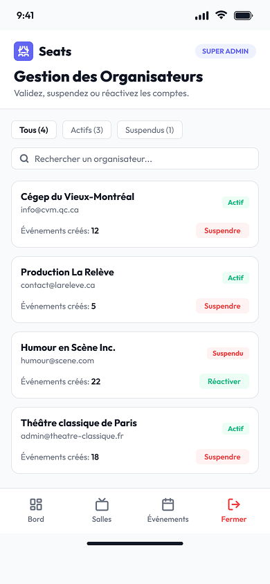

### Maquettes 11 :  Dashboard Admin confirmation
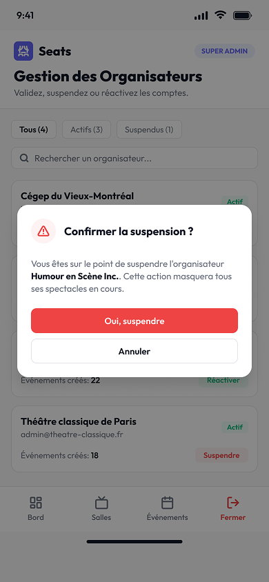

 
## 4. Registre de Décisions Techniques
 
### Décision 1 : Authentification — JWT vs Session
 
**Question** : Comment gérer l'authentification et la persistance de session?
 
**Options envisagées** :
1. **JWT (token stateless)** : Génère un token signé, stocké côté client. Pas d'état serveur.
2. **Session serveur + cookies** : Stocke session sur serveur, cookie de session côté client.
 
**Choix** : **JWT + HttpOnly Cookies**
- Token JWT signé, payload contient `userId`, `role`
- Cookie `HttpOnly` (non accessible en JS, protection XSS)
- Durée courte (1h), refresh token pour renouvellement (optionnel)

**Mise à jour (sprint 2)** : l'implémentation n'utilise pas de cookie pour le JWT. Le token est conservé côté client (SecureStore sur mobile, stockage du navigateur sur le web) et envoyé dans l'en-tête `Authorization: Bearer <token>`. Le seul cookie httpOnly sert au `state` de la connexion GitHub (voir décision 7).
 
**Raison** : 
- Simple pour API REST et stateless
- Scalable si besoin multi-serveurs
- Compatible WebSocket (futur Sprint 2)
 
**Coût** :
- Plus complexe à révoquer immédiatement (on attend l'expiration)
- Nécessite HTTPS en production
- Gestion de refresh token au Sprint 2+
 
---
 
### Décision 2 : Modèle de Données — Places Immuables vs Flexibles
 
**Question** : `places_totales` d'une projection doit-il être modifiable après création?
 
**Options envisagées** :
1. **Immuable** : Une fois la projection créée, `places_totales` est figé. Pas d'édition.
2. **Mutable** : Admin peut changer le nombre de places (ex: ajouter une salle, réduire après quelques réservations).
 
**Choix** : **Immuable**
 
**Raison** :
- Évite les incohérences (si 40 places sur 50 sont réservées, réduire à 30 créerait un conflit)
- Simplifie le calcul de `places_disponibles` = `places_totales - COUNT(réservations confirmées)`
- Admin crée une nouvelle projection s'il faut changer capacité
 
**Coût** :
- Moins flexible, mais acceptable au MVP
- Si besoin futur, créer migration et logique de gestion d'overbooking (Sprint 3+)
 
---
 
### Décision 3 : Gestion d'Images — Upload Local vs Cloud Storage
 
**Question** : Où et comment stocker les affiches de films?
 
**Options envisagées** :
1. **Local** : Serveur stocke images dans `/public/uploads/`
2. **Cloud (S3, Cloudinary, Supabase)** : Tiers externe, CDN inclus
3. **URL externe** : Admin fournit URL directement
 
**Choix** : **URL externe + Cloud Storage optionnel au Sprint 2**
- Sprint 1 : Admin passe une URL (ex: depuis TMDb, IMDB, ou local temporaire)
- Sprint 2+ : Implémenter S3 / Cloudinary pour upload
 
**Raison** :
- MVP rapide : pas de dépendance externe au Sprint 1
- Données testables sans fichiers
- Clarté : API prête, implémentation upload report
 
**Coût** :
- Admin doit trouver URL valide
- Images cassées si lien tiers expire
- Futur : migration vers S3 obligatoire en production

---

### Décision 4 : Accès aux données — Prisma + migrations versionnées

**Question** : Comment le backend accède-t-il à Postgres, et comment le schéma évolue-t-il dans le temps ?

**Options envisagées** :
1. **SQL brut** : requêtes écrites à la main avec `pg`.
2. **Prisma ORM + migrations** : schéma déclaré dans `schema.prisma`, migrations générées et versionnées dans `prisma/migrations/`.

**Choix** : **Prisma + migrations**
- Le schéma (`backend/prisma/schema.prisma`) est la source de vérité du modèle de données.
- Chaque changement de schéma est une migration SQL versionnée dans `prisma/migrations/` (ex. `ajouter_affiche_evenement`, `ajouter_tarif_evenement`), appliquée avec `npx prisma migrate deploy`.

**Raison** :
- Le schéma et son historique vivent dans le code (revue de PR possible), pas seulement en tête de quelqu'un.
- Mêmes migrations appliquées en local, en CI et en production → pas de dérive entre environnements.

**Coût** :
- Une migration mal écrite peut verrouiller une table en production ; à surveiller à mesure que les tables grossissent.

---

### Décision 5 : Déploiement — Docker Compose + image publiée sur GHCR

**Question** : Comment lancer le backend et sa base en local, et comment le livrer en production ?

**Choix** : **`docker-compose.yml` pour le Postgres local + image Docker publiée sur ghcr.io**
- `docker compose up -d` démarre un Postgres local identique à celui utilisé en CI (mêmes identifiants, même nom de base) pour que les commandes soient reproductibles en local comme en CI.
- Le `Dockerfile` (`backend/Dockerfile`) construit l'image de l'API ; la CI (`.github/workflows/ci.yml`, job `image`) la publie sur `ghcr.io/<owner>/seats-backend`, taguée `latest` et `sha-<commit>`, uniquement si les tests passent et seulement sur le tag `latest` (pas à chaque push).

**Raison** :
- Un seul `docker compose up` suffit pour développer sans installer Postgres localement (voir vision du projet).
- GHCR est inclus gratuitement avec GitHub, pas de compte tiers à gérer ; `GITHUB_TOKEN` suffit, aucun secret à créer.

**Coût** :
- Le tag `latest` est mobile (`git tag -f` + push force) : publier une nouvelle image demande une étape manuelle, pas un déploiement continu automatique.

**Mise à jour (sprint 2, #19)** : pour l'adresse publique, l'application est déployée sur **Render** avec la base **Supabase** (`render.yaml`, procédure dans [07-deploiement.md](07-deploiement.md)). Render construit les mêmes `Dockerfile` et redéploie automatiquement chaque service après un commit sur `main` de son dépôt ; le backend applique les migrations au démarrage. Le serveur du département, envisagé d'abord, n'était plus disponible. Coût : l'offre gratuite met un service en veille après 15 minutes sans visite (premier chargement de 30 à 60 s), et la construction du frontend doit tenir dans 512 Mo de mémoire (Seats-Frontend PR #131).

---

### Décision 6 : Stratégie de tests — mocks en unitaire, vrai Postgres en intégration

**Question** : Comment tester la logique métier sans dépendre d'une vraie base à chaque exécution, tout en validant les garanties que seule la base peut fournir (ex. contrainte d'unicité sous accès concurrent) ?

**Choix** : **Deux suites séparées**
- Tests unitaires (`*.test.js`) : Prisma est simulé (`src/lib/__mocks__/prisma.js`), le client généré n'est jamais requis. Rapides, aucun secret ni base nécessaire, job `test` de la CI.
- Tests d'intégration (`*.integration.test.js`) : tournent contre un vrai Postgres (service Docker en CI, `docker-compose.yml` en local), job `test-integration` de la CI. Utilisés pour prouver des garanties réelles de la base (ex. unicité `(siegeId, evenementId)` sous confirmation concurrente).

**Raison** :
- Les mocks ne peuvent pas prouver qu'une contrainte d'unicité tient sous accès concurrent réel ; seul un vrai Postgres le peut.
- Séparer les deux garde la suite unitaire rapide et sans dépendance, tout en gardant une suite d'intégration qui attrape les régressions que les mocks masqueraient.

**Coût** :
- Deux suites à maintenir ; la suite d'intégration est plus lente et nécessite Postgres (Docker) pour tourner en local.

---

### Décision 7 : Connexion externe avec GitHub (OAuth 2), à côté de l'inscription

**Question** : Comment répondre à l'exigence de la bêta (« connexion GitHub ») sans perdre la possibilité de choisir son rôle ni les comptes de démonstration ?

**Options envisagées** :
1. Garder l'inscription par mot de passe et ajouter GitHub à côté.
2. GitHub seul, inscription par mot de passe retirée, comptes de démonstration conservés.
3. Passer par un service d'authentification tiers (Auth0, Supabase Auth).

**Choix** : **Option 1** (l'option 2 a été appliquée le 26 octobre puis annulée le jour même, voir le journal)
- Flux OAuth 2 « authorization code » implémenté dans le backend (`/api/auth/github`, `/api/auth/github/callback`).
- Un `state` aléatoire, gardé dans un cookie httpOnly, protège contre le CSRF ; le secret de l'OAuth App reste côté serveur.
- Le compte est retrouvé par `githubId`, sinon relié à un compte existant **uniquement par courriel vérifié par GitHub**, sinon créé avec le rôle `spectateur`.
- Le backend émet le **même JWT** que la connexion par mot de passe : rôles et permissions sont vérifiés de la même façon.
- Le JWT revient au frontend dans le fragment de l'URL (`#token=`), jamais envoyé à un serveur ni gardé dans les journaux, et effacé dès sa lecture.
- Les **comptes de démonstration** (un par rôle, mot de passe `Demo1234!`) sont conservés et recréés au démarrage : ils se connectent toujours par courriel et mot de passe, ce qui permet de tester chaque rôle sans compte GitHub.
- L'inscription reste le seul endroit où l'on choisit d'être organisateur. Ses boutons de connexion externe envoient le rôle sélectionné (`?role=spectateur|organisateur`) : il est gardé dans le cookie de la tentative et appliqué **uniquement à un compte créé à cette connexion**. Sans ce paramètre (page de connexion), le rôle par défaut `spectateur` s'applique ; `administrateur` est refusé.

**Raison** :
- Sans inscription, plus personne ne pouvait devenir organisateur sans intervention d'un administrateur (option 2 abandonnée pour cette raison).
- Un compte inscrit par mot de passe peut ensuite se connecter avec GitHub (ou Google) : il est relié par courriel vérifié et garde son rôle.
- Un service tiers ajouterait une dépendance et des secrets de plus, pour un flux qui tient en deux routes.

**Coût** :
- Deux façons de créer un compte à maintenir et à tester.
- Des mots de passe (hachés avec bcrypt) restent stockés.
- Un compte créé depuis la page de connexion reste `spectateur` ; pour qu'il devienne organisateur après coup, il faudra l'écran administrateur de changement de rôle (#121).
- L'URL de callback doit correspondre exactement à celle de l'OAuth App : risque de connexion qui marche « chez nous » mais pas ailleurs (voir risque 6 de `06-risques.md`).

---

### Décision 8 : Google et Microsoft avec OpenID Connect (#114)

**Question** : Comment ajouter d'autres fournisseurs de connexion sans écrire un flux différent pour chacun ?

**Options envisagées** :
1. Un flux OAuth 2 par fournisseur, comme pour GitHub (appel à l'API de profil de chacun).
2. OpenID Connect générique : découverte (`/.well-known/openid-configuration`) et ID token signé, avec une bibliothèque de vérification.
3. Inclure aussi Apple.

**Choix** : **Option 2, sans Apple**
- Routes génériques `/api/auth/:fournisseur` et `/api/auth/:fournisseur/callback` ; ajouter un fournisseur = une entrée de configuration et deux variables d'environnement.
- `state` (CSRF), `nonce` (rejeu de l'ID token) et PKCE (code intercepté), gardés dans un cookie httpOnly le temps de la connexion.
- ID token vérifié avec `jose` : signature avec les clés publiques du fournisseur, audience, émetteur (y compris l'émetteur par tenant de Microsoft) et nonce. `openid-client` v6 a été écarté parce qu'il n'existe qu'en ESM, alors que le backend est en CommonJS.
- Table `IdentiteExterne (fournisseur, sujet)` plutôt qu'une colonne par fournisseur.
- Liaison à un compte existant par courriel vérifié (`email_verified`) pour Google seulement ; jamais pour Microsoft, qui ne garantit pas ce champ pour les comptes personnels.

**Raison** :
- Un seul flux à maintenir et à tester pour tous les fournisseurs OIDC.
- L'ID token prouve l'identité sans appel supplémentaire à une API de profil.

**Coût** :
- Apple est écarté : compte développeur payant, callback HTTPS sur un vrai domaine (`localhost` refusé), secret client à signer soi-même.
- Google exige des pages publiques (accueil, confidentialité) pour publier l'application ; sans publication, seuls les utilisateurs de test peuvent se connecter.
- Le secret Microsoft expire (180 jours) et doit être renouvelé.
- Un compte Microsoft sans courriel vérifié reçoit une adresse technique (`<sujet>@microsoft.invalid`).

---

### Décision 9 : Temps réel avec Socket.IO (WebSocket) (#8, #31)

**Question** : Comment montrer à tous les spectateurs d'un même plan, sans recharger la page, qu'un siège vient d'être sélectionné ou réservé par quelqu'un d'autre ?

**Options envisagées** :
1. **Sondage (polling)** : chaque client redemande le plan toutes les quelques secondes.
2. **Server-Sent Events** : flux du serveur vers le client seulement.
3. **WebSocket avec Socket.IO** : connexion bidirectionnelle, salons et reconnexion automatique.
4. **Service géré** (Supabase Realtime, Pusher).

**Choix** : **Option 3, Socket.IO**
- Le serveur Socket.IO partage le serveur HTTP de l'API (même port, même déploiement).
- Un salon par événement : seuls les clients qui regardent ce plan reçoivent ses messages.
- Le JWT de l'API sert aussi à authentifier la connexion WebSocket. Un visiteur anonyme voit le plan bouger, mais seul un spectateur connecté peut sélectionner.
- Les sélections en cours sont gardées en mémoire par le serveur, avec un délai de 60 s. Un siège redevient libre à l'expiration, à la désélection ou à la déconnexion du spectateur.
- `POST /api/reservations` vérifie aussi ces sélections (409), pour qu'une requête directe ne puisse pas prendre un siège qu'un autre est en train de choisir.

**Raison** :
- La sélection d'un siège doit apparaître chez les autres en moins d'une seconde ; un sondage assez rapide pour ça chargerait inutilement le serveur.
- Socket.IO gère les salons, la reconnexion et le repli si le WebSocket est bloqué, ce que les Server-Sent Events n'offrent pas dans les deux sens.
- Pas de service tiers de plus à configurer.

**Coût** :
- Les sélections en mémoire sont perdues au redémarrage du serveur et ne fonctionnent qu'avec une seule instance. Pour plusieurs instances, il faudrait les garder en base (réservations `en_selection`) ou ajouter un adaptateur Redis.
- L'hébergeur doit accepter les WebSocket.
- Le CORS du serveur Socket.IO est ouvert à toutes les origines, à restreindre en production.

---

### Décision 10 : Annuler une réservation sans l'effacer (#14, #12)

**Question** : Comment annuler une réservation en libérant le siège, tout en la gardant dans l'historique du spectateur, alors que la contrainte UNIQUE(siege_id, evenement_id) interdit une deuxième réservation du même siège ?

**Options envisagées** :
1. **Supprimer la ligne** : le siège est libéré, mais l'historique et le motif sont perdus.
2. **Index unique partiel** (`WHERE statut <> 'annulee'`) : Prisma ne sait pas le déclarer dans le schéma ; il faudrait l'écrire à la main dans une migration, et le schéma ne serait plus la source de vérité (décision 4).
3. **Colonne `actif` dans la contrainte** : `true` pour une réservation active, NULL une fois annulée, et UNIQUE(siege_id, evenement_id, actif).

**Choix** : **Option 3**
- L'annulation passe le statut à `annulee`, met `actif` à NULL et enregistre la date et le motif, en une seule requête conditionnelle (`statut <> 'annulee'`) : deux annulations simultanées ne peuvent pas réussir toutes les deux (409 pour la seconde).
- Le spectateur garde la réservation dans « Mes réservations », avec le motif de l'organisateur.

**Raison** :
- Postgres considère deux NULL comme différents dans une contrainte unique : les réservations annulées s'accumulent sans bloquer le siège, et il ne peut toujours y avoir qu'une seule réservation active.
- La garantie contre les doubles réservations reste dans la base (décision 6). Des tests d'intégration le vérifient : un siège annulé peut être réservé de nouveau, et de deux réservations simultanées une seule passe.

**Coût** :
- La contrainte repose sur un comportement de Postgres qui n'est pas évident à la lecture : il est expliqué en commentaire dans le schéma.
- `actif` et `statut` doivent rester cohérents ; seul le service d'annulation les modifie.

---

### Décision 11 : Sections tarifaires dans la salle, prix calculé par siège (#11)

**Question** : Où ranger les tarifs différents (parterre, balcon) et comment calculer le prix de chaque place ?

**Options envisagées** :
1. Tarifs par **événement** (une grille de prix par événement).
2. Sections dans la **salle**, chaque siège rattaché à au plus une section.

**Choix** : **Option 2**
- Une table `SECTIONS` liée à la salle, et une colonne `section_id` facultative sur chaque siège : un siège ne peut pas appartenir à deux sections.
- Le prix d'une place est celui de sa section, sinon le tarif de l'événement. Il est calculé par le backend (plan, réservations, recette du tableau de bord) : le frontend ne fait que l'afficher.
- Les sections se remplacent en bloc (`PUT /api/salles/:id/sections`), et ne sont plus modifiables dès qu'un événement utilise la salle, comme la salle elle-même (#10).

**Raison** :
- Le découpage en parterre et balcon dépend du lieu, pas de l'événement : on le configure une fois par salle.
- Verrouiller les sections une fois la salle utilisée évite qu'un prix change après la vente des billets.

**Coût** :
- Pas de prix différent par événement pour une même section : il faut une autre salle, ou le tarif de l'événement pour les sièges hors section.
- Modifier la disposition d'une salle (#10) régénère les sièges, qui repartent sans section.

---

### Décision 12 : Rôles vérifiés côté serveur sur chaque route (#9, #33)

**Question** : Comment empêcher qu'une requête directe à l'API (par exemple avec `curl`) contourne les restrictions de l'interface ?

**Choix** : **Middlewares sur chaque route + vérification de propriété dans les services**
- `authMiddleware` vérifie le JWT, `roleMiddleware('<rôle>')` refuse (403) tout autre rôle. Les deux sont déclarés route par route.
- L'identité vient toujours du token (`organisateurId`, `spectateurId`), jamais du corps de la requête.
- La propriété est vérifiée dans le service : un organisateur ne voit et n'annule que les réservations de ses propres événements, un spectateur n'annule que les siennes.
- Un test automatisé (`acces-par-role.test.js`) appelle chaque route protégée avec chaque rôle et vérifie le refus.

**Raison** :
- Masquer un bouton ne protège rien : la règle doit vivre dans le serveur.
- Un test qui parcourt toutes les routes attrape la route ajoutée sans protection.

**Coût** :
- Chaque nouvelle route doit déclarer ses middlewares et être ajoutée au test ; un oubli n'est détecté que si le test est mis à jour.

---

### Décision 13 : Tableau de bord des ventes en direct, d'abord par sondage puis par WebSocket (#13, #35)

**Question** : Comment le tableau de bord de l'organisateur suit-il les ventes en direct ?

**Options envisagées** :
1. **Sondage** : l'écran redemande `GET /api/evenements/:id/ventes` à intervalle régulier.
2. **WebSocket** (serveur Socket.IO de la décision 9) : le serveur pousse les ventes recalculées dès qu'elles changent.

**Choix** : **Option 1 pour #13, remplacée par l'option 2 avec #35**
- #13 (19 octobre) : sondage toutes les 5 s, parce que le serveur Socket.IO n'était pas encore fusionné.
- #35 (29 octobre) : après chaque réservation ou annulation, le backend recalcule les ventes et les pousse (`ventes:maj`) dans un salon `ventes:<id>` séparé du salon public du plan. Le tableau de bord ne fait plus qu'une requête au chargement, puis écoute le socket.
- Seul l'organisateur de l'événement peut rejoindre ce salon : le serveur le vérifie, parce que les ventes contiennent le nom et le courriel des spectateurs.

**Raison** :
- La mise à jour est immédiate, au lieu d'un délai jusqu'à 5 s et d'une requête par écran toutes les 5 s même sans changement.
- Le calcul des ventes reste le même que pour `GET /api/evenements/:id/ventes` : une seule source de vérité.

**Coût** :
- La diffusion est faite au mieux : si elle échoue, la réservation reste valide, mais le tableau de bord n'est à jour qu'au prochain chargement de la page.
- Les ventes ne sont poussées qu'après une réservation ou une annulation en base. Une sélection en cours (en mémoire, décision 9) ne les déclenche pas.
